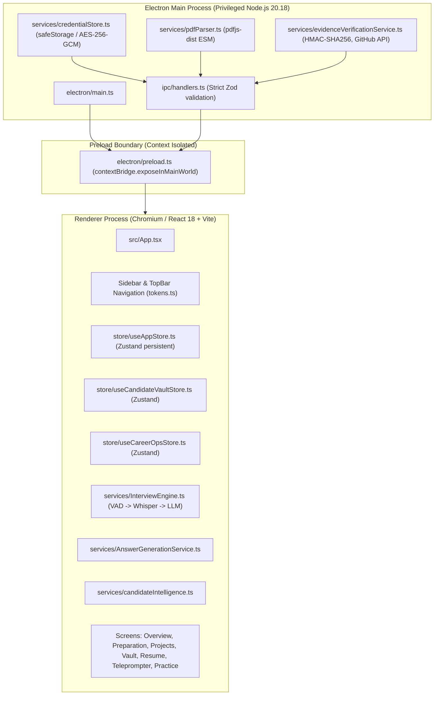
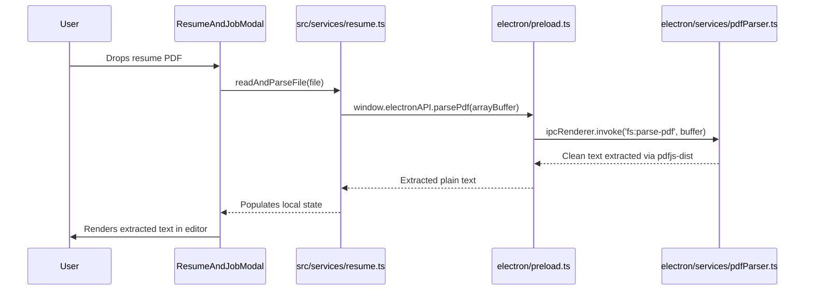

> **Historical snapshot — superseded by the current audit.** This document records findings as of 2026-10-31 and is not a current security certification. Its statement that provider credentials are “never exposed to renderer window memory” is inaccurate for the current code: `getApiKey()` is exposed through preload and decrypted credentials are consumed by renderer code. See [ENGINEERING_AUDIT_2026-11-10.md](./ENGINEERING_AUDIT_2026-11-10.md) for confirmed current findings and remediation status.

# IAC Engineering Baseline Audit & Architecture Assessment

**Date**: 2026-10-31  
**Repository**: https://github.com/Abhitvg/IAC  
**Branch**: `main`  
**Commit SHA**: `851e7f2`  
**Auditor**: Principal Full-Stack Engineer, AI Systems Architect & Electron Security Engineer  

---

## 1. Executive Summary & Baseline Validation

Prior to code modernization, all existing automated test suites, typecheckers, security linters, and end-to-end integration tools were executed to record exact baseline telemetry:

| Command | Status | Result / Telemetry |
| :--- | :--- | :--- |
| `npm test` | **PASSED** | 41 test files passed, 440 tests passed, 1 skipped (duration: 2.36s, 80.65% statement coverage) |
| `npm run typecheck` | **PASSED** | `tsc --noEmit && tsc -p tsconfig.electron.json --noEmit` exited with 0 errors |
| `npm run lint` | **PASSED** | `eslint electron/ src/` exited with 0 errors (132 allowable unused-argument warnings) |
| `npm run security:check` | **PASSED** | `verify-no-secrets.js` found 0 API keys or plain credentials in `dist/` and `dist-electron/` |
| `npm run build` | **PASSED** | Vite web bundle (`1,160 kB`) + Electron main (`49 kB`) + pdf parser bundle built in 8.00s |
| `npm run test:e2e` | **PASSED** | Playwright Electron launch window verification passed in 3.8s |

---

## 2. Existing Architecture & System Topology

IAC is an Electron desktop application running on macOS, Linux, and Windows, orchestrating real-time interview practice and intelligence.

---

## 3. Current Candidate Knowledge Lifecycle

1. **Ingestion**: Raw text or uploaded documents (`.pdf`, `.docx`, `.txt`, `.md`) enter via `ResumeAndJobModal.tsx` or `readAndParseFile()`.
2. **Parsing**: Currently done by regex heuristics in `candidateIntelligence.ts` and `resume.ts`.
3. **Storage**: Extracted records are mirrored in `useAppStore` and `useCandidateVaultStore`.
4. **Defect**: Fabricated default state was seeded in `useCandidateVaultStore` and `useCareerOpsStore` (e.g., hardcoded personal identities, fake Alignerr applications).

---

## 4. Current Resume Ingestion Lifecycle

---

## 5. Current Website Source Functionality

- **Status**: Currently non-existent as an active pipeline. There is no automated crawler, HTML text extractor, or SSRF-hardened fetching module for external candidate portfolios.
- **Requirement**: Must build `src/services/website/` with comprehensive SSRF protection, robots/sitemap parsing, and `WEBSITE_REPORTED` claim provenance.

---

## 6. Question-Answer Generation Flow & Separation of Concerns

- **Domain A (Candidate Personal Knowledge)**: Personal projects, verified commit authorship, verified metrics, employment history.
- **Domain B (General Technical Knowledge)**: Algorithms, Java concurrency, Kafka, distributed systems, system design, RAG, OS.
- **Invariant**: General technical questions must succeed even if the candidate knowledge vault is completely empty. Domain B answers must never claim candidate ownership.

---

## 7. Current Provider Resolution Logic

- Handled in `src/services/ai.ts` via `LLMManager`.
- Supported providers: `groq`, `openai`, `openrouter`, `ollama` (local offline).
- Keys are secured via Electron `safeStorage` in `electron/services/credentialStore.ts`.

---

## 8. Electron Security Boundaries

1. `contextIsolation: true` and `nodeIntegration: false` enforced in `electron/main.ts`.
2. Credentials stored in OS keychain via `safeStorage`, never exposed to renderer window memory.
3. IPC channels validated strictly via Zod schemas in `electron/ipc/handlers.ts`.
4. No direct shell execution or unconstrained filesystem access from renderer.

---

## 9. Root Causes of Known Defects & Target Modernization Files

| Defect / Opportunity | Root Cause | Target Files |
| :--- | :--- | :--- |
| Fabricated candidate defaults | Hardcoded demo values in initial Zustand state | `src/store/useCandidateVaultStore.ts`, `src/store/useCareerOpsStore.ts` |
| Hardcoded Alignerr target context | Static default role & JD strings in `candidatePersona.ts` | `src/services/candidatePersona.ts`, `src/types/index.ts` |
| Ingestion pipeline rigidity | Monolithic regex in `resume.ts` | `src/services/ingestion/` (new multi-stage modular pipeline) |
| Missing personal website ingestion | Feature was not implemented | `src/services/website/` (new crawler, SSRF guard, HTML extractor) |
| Knowledge Vault unstructured data | Claims stored as unlinked text arrays | `src/services/candidateIntelligence.ts`, `src/store/useCandidateVaultStore.ts` |
| Loosely typed answer generation | `Promise<any>` and callback polymorphism | `src/services/AnswerGenerationService.ts` |

---

## 10. Risks & Mitigation Plan

- **Risk: Breaking existing live teleprompter or practice mode**: Mitigated by running the full 41 test suites after each milestone and keeping service signatures backward-compatible.
- **Risk: SSRF attacks when fetching candidate URLs**: Mitigated by implementing strict private IP / link-local / DNS rebinding / redirect guards in `urlSafetyPolicy.ts`.
- **Risk: Re-introducing fabricated candidate state**: Mitigated by adding dedicated regression tests asserting empty initial state on fresh install.

