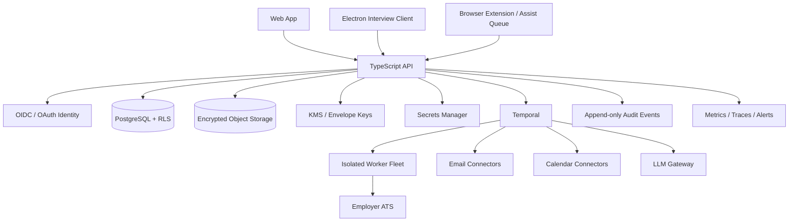

# CareerOps Cloud Architecture

**Status:** Proposed target architecture; implementation starts at M0.
**Baseline:** `main` at `6a24b0b44271658c75fff68f798c1a9f8e1e68f4`.

## Product boundary

CareerOps becomes a cloud-hosted multi-tenant job-search service. The Electron application remains the live-interview client for audio capture, Whisper transcription, AI assistance, interview sessions and local device features. The desktop client authenticates to the cloud API for account, CareerOps and optional session synchronization. Local interview execution must continue to work during a cloud outage wherever current product behavior permits.

## Logical topology

## Repository layout target

- `apps/web`: onboarding, Career Graph, tracker, activity feed, Assist Queue, Sprint dashboard, reports and account settings.
- `apps/api`: authenticated versioned HTTP API, OAuth callbacks, tenant context, consent, audit, rate limits and domain commands.
- `apps/worker`: Temporal workers and isolated job execution entrypoints.
- `apps/electron` (migration target): existing Electron client retained; avoid disruptive path moves until cloud API is stable.
- `packages/contracts`: Zod schemas and generated API contracts shared by web, API, worker and desktop.
- `packages/domain`: tenant-scoped domain models and pure policy functions.
- `packages/connectors`: plugin interfaces and connector implementations.
- `packages/llm-gateway`: provider routing, schema validation, prompt versions, budgets and evaluations.
- `packages/security`: tenant context, consent checks, audit event contracts, encryption metadata and suppression checks.
- `infra/`: infrastructure-as-code, deployment, KMS, database, Temporal, storage, secrets and observability configuration.

This layout is a target; preserve the existing Electron source tree until a migration PR has passing tests and clear ownership.

## Tenant and identity model

- A tenant represents an individual user account initially. Organization/team tenancy can be added without changing the isolation model.
- Every tenant-owned row has a non-null `tenant_id`. Foreign keys include tenant scope where practical.
- API middleware validates the identity token, resolves the tenant from server-side membership, starts a transaction and sets transaction-local tenant context.
- PostgreSQL RLS policies enforce tenant isolation on every tenant table. App-level filters are additional defense, never the sole control.
- Workers receive scoped, short-lived job credentials; never trust a tenant ID supplied only in a queue payload.
- Background jobs set and verify tenant context at transaction start. Cross-tenant queries require explicit privileged service roles and audited justification.
- Tenant IDs are not authorization secrets.

## Data and encryption

- PostgreSQL stores structured domain state, consent, workflow state, audit references and metrics.
- Object storage stores resumes, exports, screenshots, application proof, audio and generated artifacts. Object keys are opaque; access is through short-lived signed URLs after tenant authorization.
- KMS envelope encryption: tenant-scoped data-encryption keys (DEKs), wrapped by a KMS key-encryption key. Store key version and encryption context; rotate DEKs and KEKs without exposing plaintext keys to application logs.
- OAuth refresh/access tokens live in a secrets manager, referenced by opaque secret IDs. Database stores provider, scopes, expiry, owner and secret reference only.
- Sensitive fields may use application-level envelope encryption in addition to storage/database encryption. Key lifecycle and recovery are first-class workflows.
- Logs, traces and metrics must exclude resume text, email bodies, tokens, audio, contact details and prompt payloads by default.
- Retention is purpose-based and configurable; support DSAR export/delete and deletion propagation across DB, object store, workflow payloads, search indexes, backups (subject to documented backup expiry) and provider tokens.

## Consent and execution authorization

A signed Sprint Contract is versioned and immutable after acceptance. Amendments create a new version. Every action is authorized against the currently active contract at execution time, not merely at workflow creation time.

Contract fields include:

- target roles, seniority, geographies, remote preferences, salary floor and currency;
- work authorization and sponsorship facts with provenance/verification;
- company/industry blocklists;
- enabled channels and permitted action types;
- daily/weekly caps, per-company/contact caps and quiet hours;
- default answers and the facts each answer is allowed to use;
- tone, sender identity, opt-out wording, jurisdictions and lawful basis/consent records;
- sprint start/end, expiration, revocation and emergency stop state.

Global kill switch and per-channel pause are server-enforced. A pause is checked immediately before every irreversible side effect. A queued action cannot bypass a later revocation.

## Domain modules

### Career Graph

Canonical facts have source, user confirmation state, confidence, valid-from/to and evidence references. Distinguish:
- imported but unconfirmed fact;
- derived inference;
- stale or disputed fact.

Only confirmed facts may support outbound claims. The truthfulness verifier maps each generated claim to one or more confirmed facts and blocks any unsupported, contradicted or stale claim. Golden-set failures block release; 100% detection on planted false claims is a hard acceptance gate, not a claim of perfect real-world truth.

### Plugin contracts

- `JobSource`: discover/list/fetch normalized job postings; declares source terms, rate limits, freshness and provenance.
- `ApplyAdapter`: assess eligibility, map fields, submit only approved supported ATS flows, return idempotency key and proof artifact. CAPTCHA/login/MFA/unknown question routes to Assist Queue.
- `MessageChannel`: capability declaration, consent and jurisdiction checks, send/reply/webhook support, suppression and health signals.
- `ContactSource`: import or enrich contacts under licensed terms; records provenance, lawful access basis and refresh/expiry.

Connectors cannot directly invoke other connectors or change consent. Domain policy authorizes every side effect.

## Workflow orchestration

Temporal is the durable orchestrator. Workflows are deterministic; network calls, LLM calls, DB writes and browser operations execute as activities with bounded retries, timeouts and idempotency. External text is passed as opaque activity data, never as workflow instructions.

Key workflows:

- `SprintWorkflow`: time-bounded coordinator, daily allocation, channel pauses, end-of-sprint report.
- `DiscoveryWorkflow`: source polling, normalization, dedupe and ghost/scam screening.
- `EvaluateAndPrepareWorkflow`: relevance, A–H evaluation, score, answer generation and truth gate.
- `ApplyWorkflow`: preflight, duplicate check, consent recheck, ATS submission, proof capture and tracker update.
- `OutreachWorkflow`: contact eligibility, cap/cooldown/suppression, quiet hours, send and reply stop.
- `InboxWatchWorkflow`: connector polling/webhooks, classification, response policy and calendar actions.
- `InterviewPrepWorkflow`: event context, role/company prep and reminders.
- `DSARWorkflow`: export/delete orchestration and verification.

All workflows have idempotency keys, cancellation paths, activity audit records and bounded resource budgets.

## Channel safety

### C1 ATS

Use supported employer ATS endpoints/pages only. Before submission, recheck contract, blocklists, score threshold, ghost/scam result, duplicate state, required answers, daily cap and kill switch. Unknown/sensitive questions without a confirmed default skip the job. CAPTCHA, login or MFA goes to Assist Queue. Store screenshot and normalized submission payload as proof; redact unnecessary PII from telemetry.

### C2 Email

Send through the user's authorized Gmail, Microsoft Graph or explicitly configured IMAP/SMTP connector, subject to provider terms and OAuth review. Only public or licensed-provider-verified business channels; no guessing or SMTP probing. Enforce sender identity, opt-out, global suppression, regional compliance, consent, 3 contacts/company/role, 30-day person cooldown, recipient-local quiet hours and adaptive daily caps. Stop on reply, bounce, complaint or opt-out. Follow-ups only at contract-authorized intervals and stop after day 4 for Sprint Mode.

### C3 Referrals

Detect official referral portals and eligible referral paths. Contact ranking uses only consented/imported or public-source data with provenance. LinkedIn actions remain in Assist Queue.

### C4 LinkedIn

Official OAuth/OpenID sign-in and basic profile only; user-uploaded connection export import; profile audit and guidance. No server-side passwords/cookies, scraping, profile visits, connection requests, messages, likes or other unattended LinkedIn actions. Assist Queue items are prepared content; each action requires an explicit user gesture in their own browser.

### C5 Inbound

Classify inbound messages as untrusted content. Only approved templates/actions may reply. Propose/accept calendar slots only within explicit availability and contract policy. Create events only after provider API success; use idempotency keys and audit. Target <15 minute response time as an SLO, not a guarantee.

## LLM gateway and prompt-injection isolation

- Provider adapters return structured output validated against versioned Zod/JSON schemas.
- Prompts are versioned and evaluated offline against benign and adversarial fixtures.
- External content is quoted/delimited as untrusted data. It cannot supply system instructions, request secrets, alter tool allowlists, change consent or authorize actions.
- The LLM gateway does not possess broad credentials. Tools are invoked only by deterministic domain workflows after policy evaluation.
- Per-tenant token/cost budgets, redaction, model allowlists, timeouts, retries and circuit breakers are mandatory.
- Generated CVs, letters, screening answers and messages pass the claim-level truthfulness gate before storage as sendable artifacts.

## Observability and auto-pause

Emit tenant-scoped traces, metrics and immutable audit events with opaque IDs. Track discovery, evaluation, apply, email, reply, interview and offer funnel rates; connector latency/errors; token costs; bounce/complaint/negative reply; truth gate blocks; cap denials; ATS failures; user pauses and restriction notices.

Auto-pause thresholds:

- bounce rate >5% over a defined minimum denominator/window;
- any spam complaint;
- mailbox-provider warning;
- ATS error spike relative to connector baseline;
- user-reported LinkedIn restriction notice pauses LinkedIn Assist Queue suggestions pending review;
- truthfulness failure spike;
- negative-reply spike.

Every threshold needs denominator, time window, hysteresis, alerting and safe resume rules. A human can always pause; automatic pause cannot be overridden by an LLM.

## Forecasting

Forecast interviews as a distribution/range, not a point promise. Start with transparent population priors and update only from sufficiently sampled tenant funnel data. Show sample size, prior source, credible interval, calibration date and uncertainty. Suppress personalized forecasts when minimum-sample guardrails are not met. Never use guaranteed language.

## Sprint Mode lifecycle

- T+0: Sprint Contract, imports, Career Graph confirmation, truthfulness baseline, profile audit.
- T+0–6h: broad discovery, ghost/scam checks, evaluation, top-role tailoring, first allowed outreach/referral wave.
- T+6h onward: scheduled application waves and outreach within caps; inbox checks every five minutes where connector/provider limits permit.
- Daily: constrained allocator shifts budget based on measured conversion with exploration minimums and safety gates.
- T+72–96h: close sprint, stop scheduled sends, produce funnel/learning/report and next-step recommendation.

The allocator may optimize within the Sprint Contract; it cannot change the contract, relax policy, increase caps beyond authorized bounds, or bypass pauses.

## Delivery sequence

M0 cloud foundation → M1 Career Graph/Contract → M2 tracker/feed → M3 discovery → M4 evaluation/truth gate → M5 ATS apply → M6 mail/calendar/inbound → M7 people/outreach → M8 LinkedIn Assist Queue → M9 Sprint orchestrator/forecast → M10 analytics/billing/polish.

Each milestone ships with migrations, tests, demo script, known gaps and explicit STOP.
